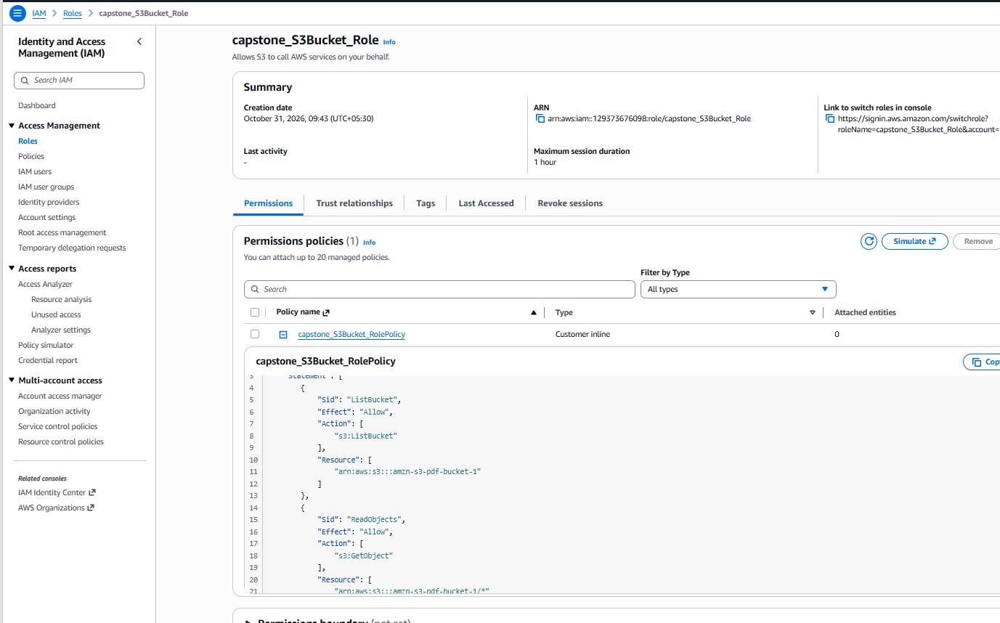
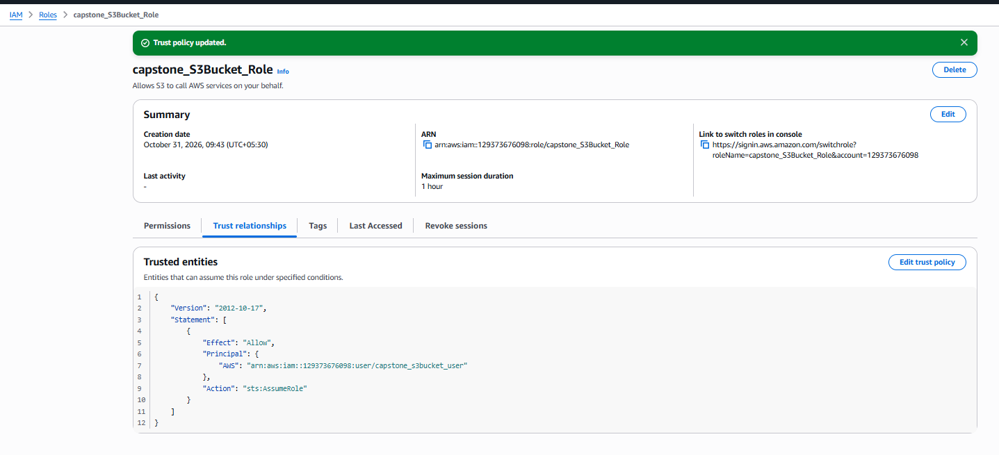
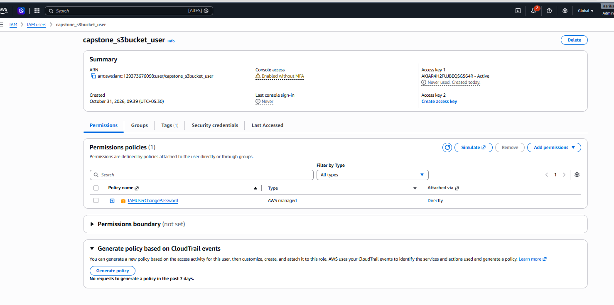

# IAM Role Permissions

> 

```
{
    "Version": "2012-10-17",
    "Statement": [
        {
            "Sid": "ListBucket",
            "Effect": "Allow",
            "Action": [
                "s3:ListBucket"
            ],
            "Resource": [
                "arn:aws:s3:::amzn-s3-pdf-bucket-1"
            ]
        },
        {
            "Sid": "ReadObjects",
            "Effect": "Allow",
            "Action": [
                "s3:GetObject"
            ],
            "Resource": [
                "arn:aws:s3:::amzn-s3-pdf-bucket-1/*"
            ]
        }
    ]
}

```

# IAM Role Trust Policy

> 

```
{
    "Version": "2012-10-17",
    "Statement": [
        {
            "Effect": "Allow",
            "Principal": {
                "AWS": "arn:aws:iam::<aws-account>:user/capstone_s3bucket_user"
            },
            "Action": "sts:AssumeRole"
        }
    ]
}
```

# IAM User

> 

# Pending Task - aws sso connection

